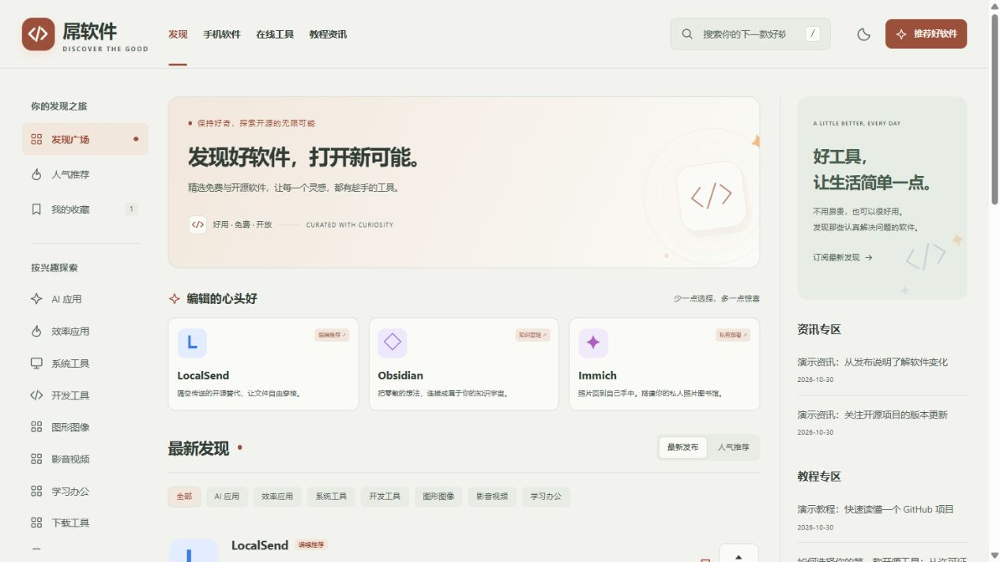

# 屌软件 Discover

一个面向软件分享、GitHub 开源项目推荐和实用工具导航的轻量 WordPress 主题。界面参考 Product Hunt 的发现列表，提供暖灰浅色与低饱和灰绿深色两种模式，适配桌面和手机。

主题内置常用运营功能，可在后台统一管理品牌、内容展示、SEO、广告、订阅和统计。

[下载主题](https://github.com/lemon360/diao-discover/releases/latest) · [更新记录](CHANGELOG.md) · [安全反馈](SECURITY.md)



## 主要功能

| 功能 | 说明 |
| --- | --- |
| 软件发现首页 | 最新发布、人气推荐、分类导航和首页精选 |
| 软件详情 | 软件介绍、支持平台、版本、许可证、官网、下载地址和 GitHub 仓库 |
| GitHub 数据 | 在编辑后台同步项目 Star、Fork、语言和许可证，前台展示缓存数据 |
| 游客推荐与收藏 | 无需登录即可推荐或撤销；收藏保存在当前浏览器 |
| 社交分享 | 支持微博、QQ、QQ 空间、X、Telegram 和微信复制链接 |
| 匿名投稿 | 无需注册，只接受文字与链接，提交后进入待审核列表，不开放文件上传 |
| 教程与资讯 | 与应用内容分开展示，提供可配置的右侧栏小工具 |
| 侧栏内容管理 | 两张介绍卡片独立开关，标题、正文、按钮和链接均可修改 |
| 邮件订阅 | 邮箱确认、退订、新文章通知、分批发送、失败重试和订阅者管理 |
| 统计与浏览量 | 自定义统计代码、文章浏览量、重复访问去重及显示开关 |
| 内置 SEO | 页面标题、描述、canonical、社交分享信息、结构化数据和站点地图 |
| 广告管理 | 首页顶部、列表内、右侧栏、正文中、正文后、页脚六个广告位 |
| 阅读体验 | 内容目录、代码复制、相关文章和原生评论 |
| 评论防护 | 一键关闭前台评论、来源限流、蜜罐、链接与关键词限制、强制审核 |
| 优化与安全 | HTML 压缩、资源清理、登录失败限流、XML-RPC 与 REST 接口限制等设置 |

主题沿用 WordPress 原生文章、页面、分类和标签，已有内容可以继续使用。前台采用原生 PHP、CSS 和 JavaScript，无需前端构建。

## 使用方法

### 配置网站外观

进入 **外观 → Discover 设置**，按分组修改：

- **品牌与外观**：站名、品牌短句、强调色、默认明暗模式、公告和工具箱链接。
- **首页与功能**：首页标题与介绍、每页数量、精选文章、分类范围，以及推荐、收藏和分享开关。
- **侧栏与文案**：两张侧栏卡片的内容、按钮功能，以及文章末尾的分享引导文字。
- **邮件订阅**：订阅入口、页面说明、发件人、通知范围和每批发送数量。
- **统计与浏览**：统计代码、输出位置、浏览量统计及前台显示。
- **SEO 与社交**：首页 SEO 标题、描述和默认分享图片。
- **广告管理**：广告总开关、各广告位的图片、链接或 HTML 代码。
- **页脚与联系**：页脚说明、备案信息和自定义投稿地址。

强调色会分别适配浅色和深色背景，自动调整文字及按钮对比度。

Logo 和站点图标在 **外观 → 自定义 → 站点标识** 设置；顶部与页脚导航在 **外观 → 菜单** 设置。

使用主题的发现首页时，在 **设置 → 阅读** 中选择「你的最新文章」。也可以保留静态首页，并指定单独的文章页。

### 发布软件

新建或编辑文章，在 **Discover · 软件信息与 SEO** 面板填写软件名称、一句话介绍、GitHub 仓库、官网、下载地址、支持平台、版本和许可证。

特色图片作为软件列表图标，正文用于详细介绍和截图。软件名称或简介未填写时，主题使用文章标题和摘要。

填写 GitHub 仓库后，点击 **同步 GitHub 数据** 获取项目数据。数据保存在本站，访客浏览页面时使用缓存展示。

在主题设置中填写最多 **3 个精选文章 ID**，即可在首页展示精选卡片。

### 分开展示教程与资讯

在 **Discover 设置 → 首页与功能** 中填写「教程/资讯分类 ID」，多个 ID 使用英文逗号分隔。对应分类及其子分类会从应用列表中分离，保留各自的分类页。留空时按常见分类名称自动识别。

进入 **外观 → 小工具 → Discover 右侧边栏**，添加 **Discover · 教程与资讯**。可添加多个实例，分别展示教程和资讯，并设置标题、分类、文章数量、排序及日期显示。

### 编辑侧栏卡片

进入 **Discover 设置 → 侧栏与文案**：

- **介绍卡片**：修改顶部小字、标题、正文和按钮文案；按钮可指向邮件订阅、RSS 或自定义链接，也可隐藏。
- **开源卡片**：修改标题、正文、按钮文案和链接。
- **文章分享文案**：修改文章末尾的引导文字，留空即可隐藏这段文字。

两张卡片均有独立开关；介绍卡片的标题和两张卡片的正文支持换行。

### 处理游客投稿

访客点击顶部「推荐好软件」，即可填写软件名称、介绍和项目链接，无需注册登录。

投稿只接收文字与链接，不支持图片或文件上传。提交后，管理员在 **文章 → 所有文章 → 待审核** 中审阅，补充分类和软件信息后发布。

如需使用其他投稿页面，可在 **Discover 设置 → 页脚与联系** 中填写自定义投稿地址。

### 开启邮件订阅

在 **Discover 设置 → 邮件订阅** 开启订阅入口，并配置订阅页标题、说明和发件人。侧栏介绍卡片的按钮功能选择「邮件订阅」，即可引导读者订阅；页脚也会显示入口。

读者填写邮箱后，需要打开确认邮件并在页面上确认，之后才接收新文章通知。每封通知都提供退订链接。

开启新文章通知后，首次发布的文章会分批发送给已确认的订阅者。默认不包含教程和资讯，可在设置中调整。邮件队列通过 WordPress 计划任务处理。

在 **外观 → Discover 邮件订阅** 中查看订阅状态、通知队列概况，删除订阅记录或导出已确认邮箱。

主题使用 WordPress 发信服务，兼容已有 SMTP 插件。也可在 `wp-config.php` 中配置主题 SMTP 常量：

```php
define('DH_SMTP_HOST', 'smtp.example.com');
define('DH_SMTP_PORT', 587);
define('DH_SMTP_ENCRYPTION', 'tls');
define('DH_SMTP_USER', 'newsletter@example.com');
define('DH_SMTP_PASSWORD', 'YOUR_SMTP_APP_PASSWORD');
```

将示例替换为自己的发信服务配置，并在后台填写对应的发件人邮箱。SMTP 插件与主题常量选择一种配置方式即可。

### 添加统计代码与浏览量

进入 **Discover 设置 → 统计与浏览**，粘贴统计服务提供的完整代码，并选择在页面头部或页脚输出。支持独立开关，默认排除已登录用户；订阅页面不输出统计代码。

文章浏览量独立于第三方统计服务，可分别控制「是否统计」和「是否在前台显示」。同一来源对同一篇文章的访问按 30 分钟去重，后台文章列表也会显示浏览量。浏览量为阅读次数估算。

### 设置 SEO、广告与分享

在 **Discover 设置 → SEO 与社交** 中设置首页标题、描述和分享图片。文章可单独填写 SEO 标题与描述；检测到 Yoast、Rank Math、AIOSEO 或 SEOPress 时，内置 SEO 自动让位。

在 **广告管理** 中开启广告并配置对应位置。支持图片与链接，也支持可信广告 HTML；没有配置的广告位不占空间。广告和统计脚本仅允许具备相应权限的管理员保存。

**文章正文中**广告默认插在第 3 个完整独立段落后，可调整段落数量或单独关闭。短文章会放在最后一个独立段落后；列表、引用和代码块中的段落不计入，没有适合段落时不插入。正文中与正文后的广告位分别配置，文章页面最多插入一处正文中广告。

开启分享功能后，文章页会提供社交平台分享菜单和复制链接入口。微信分享通过复制链接后粘贴完成。

### 关闭评论或开启垃圾留言防护

进入 **外观 → Discover 设置 → 评论防护**，选择评论模式：

- **沿用 WordPress 原有设置**：默认选项，保留文章目前的评论状态。
- **彻底关闭前台评论**：适合暂时不开评论的网站。拦截直接提交和普通用户的 REST 新增评论，关闭评论 Feed；可同时隐藏已有评论及前台入口，记录仍保留在后台。
- **开启评论防护**：只保护原本开放评论的文章，不会自动打开已关闭的评论。可启用普通评论全部先审核、蜜罐与表单校验、常见爬虫提交过滤、来源限流，以及移除评论者网站字段。

可调整同一来源的提交次数、统计窗口、最小提交间隔、正文链接数和最大字数；关键词按每行一个填写。规则不通过的提交会直接拒绝。管理员仍可在 WordPress 评论后台审核、回复和管理已有留言。

来源限流使用服务器网络地址的摘要；反向代理需在服务器正确配置真实来源，共享网络可能共用额度。蜜罐和表单标记用于过滤部分自动提交，不是人机验证码。防护仅作用于留言，不屏蔽搜索引擎正常抓取文章；高频采集或流量攻击可另在服务器、CDN 或 WAF 配置规则。更换评论模式后清理页面缓存。

### 调整优化与安全选项

进入 **外观 → Discover 优化与安全**，按网站需要开启或关闭各项功能：

- **性能优化**：HTML 源码压缩、Emoji 与头部冗余标签清理、嵌入功能控制、前台资源清理、文章修订数量和 Heartbeat 间隔。
- **基础防护**：XML-RPC、Pingback/Trackback、匿名 REST 用户列表与批量接口限制、登录失败限流、登录错误提示隐藏和后台文件编辑限制。
- **编辑体验**：经典编辑器、经典小工具和仪表盘内容设置。

HTML 压缩默认关闭，启用后保守清理标签间空白，保留脚本、样式、代码块及注释。主题保留 WordPress 的自动更新机制。

使用页面缓存或 CDN 时，将投稿页参数 `dh_submit`、订阅页参数 `dh_newsletter`、`admin-post.php` 和 `/wp-json/diao/v1/*` 排除缓存。

## 开源许可

主题代码以 **GPL-2.0-or-later** 开源，详见 [LICENSE.txt](LICENSE.txt)。部分内联 SVG 图标路径采用 Feather 图标，许可声明见 [THIRD_PARTY_NOTICES.md](THIRD_PARTY_NOTICES.md)。
